# Reference Library for ComfyUI

A reference library for ComfyUI. Keep your characters, places, props, clips and sounds in **named
libraries**, then type **`@name`** in a **Reference Prompt** and they're wired into the model when you
queue: **Nano Banana**, **Seedream**, **GPT Image**, **FLUX 3**, **Seedance**, **MiniMax H3**,
**Qwen Image**, … (see [Supported model nodes](#supported-model-nodes)). Files stay where they are on your
disk ([local libraries only](#libraries-in-detail), for now): no copying into ComfyUI's `input` folder.

> **Requires Nodes 2.0.** Turn on **Settings → Comfy → Nodes 2.0 → Modern Node Design (Nodes 2.0)**.
> The classic canvas nodes aren't supported. See [Install](#install).

> **Highly experimental: use at your own risk.** See [Disclaimer](#disclaimer).

## No image wires

**You don't connect any images to the model node.** Usually every reference image needs its own Load
Image node, wired into `image_1`, `image_2`, … of the model, and the prompt has to say "image 3" for the
right one. Here the Reference Prompt is the **only** connection: its `text` goes to the model's `prompt`,
and that's it.

<p align="center">
  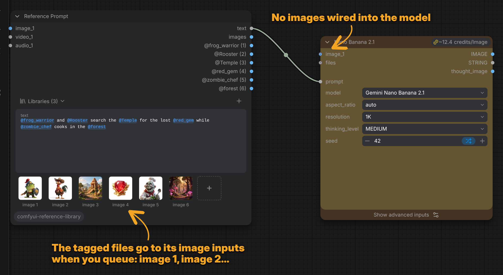
</p>

When you queue, every file you tagged is loaded and plugged into the model's image (video, audio)
inputs for you, in the order shown under the text, and `@frog_warrior` becomes `image 1` in the prompt the
model receives. Add a tag, and one more image goes along; remove it, and it's gone. The canvas stays
the same two nodes, however many references you use.

- **Asset libraries:** named collections of your files, referenced in place, shared by all workflows.
- **`@` autocomplete** with thumbnails; tags colored by state; hover a tag for a preview.
- **Manage a library** in one window: preview, rename, replace or remove its files, several at once.
- **Slices:** cut part of a library image (a face, a prop) and use it instead, without touching the library.
- **Images, videos and audio**, plus [files from other nodes](#files-that-arent-in-a-library)
  (Load Image, …), placed before or after the library files.

## Contents

- [No image wires](#no-image-wires)
- [Getting started](#getting-started)
- [Example workflow](#example-workflow)
- [Tag colors](#tag-colors)
- [What happens when you queue](#what-happens-when-you-queue)
- [Supported model nodes](#supported-model-nodes)
- [Older models with one image input](#older-models-with-one-image-input)
- [Files that aren't in a library](#files-that-arent-in-a-library)
- [Edit a library: manage its files](#edit-a-library-manage-its-files)
- [Slices: use part of an image](#slices-use-part-of-an-image)
- [Outputs: every tagged file, and a batch](#outputs-every-tagged-file-and-a-batch)
- [Libraries in detail](#libraries-in-detail)
- [Share a library: export and import](#share-a-library-export-and-import)
- [Run a workflow without the interface (API)](#run-a-workflow-without-the-interface-api)
- [Reference Image / Video / Audio nodes](#reference-image--video--audio-nodes)
- [Safety](#safety)
- [Install](#install)
- [Development](#development)
- [Disclaimer](#disclaimer)

## Getting started

### 1. The Reference Prompt node

Add it from **Add Node → Reference Library → Reference Prompt**. The header holds your libraries and the
button to add files.

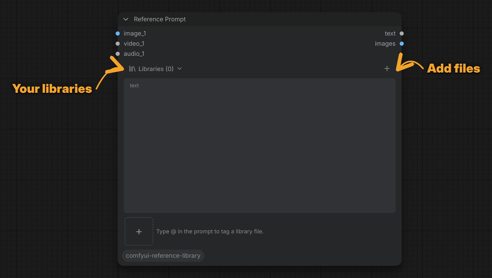

### 2. Create your first library

Open **Libraries** and click **+ New library**.

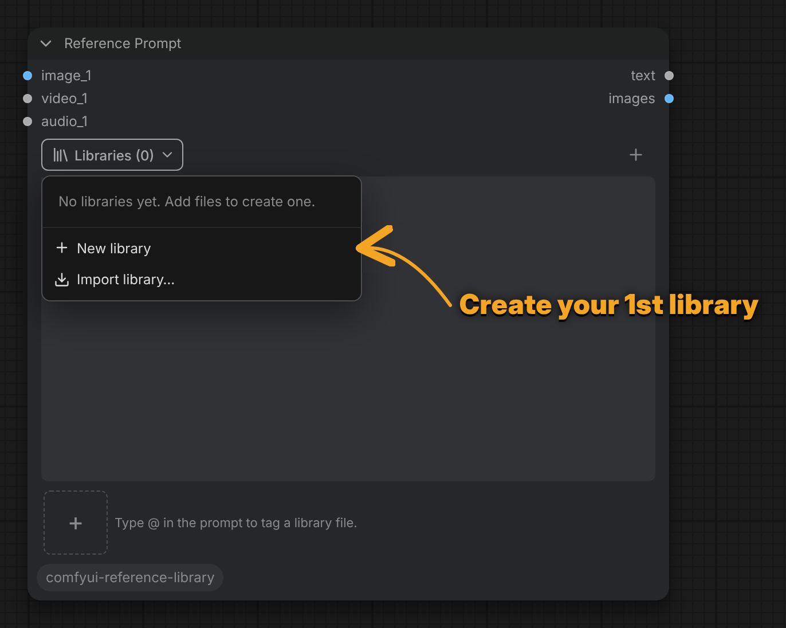

### 3. Name it, then pick files

Give the library a name. It is created as soon as the first file is added.

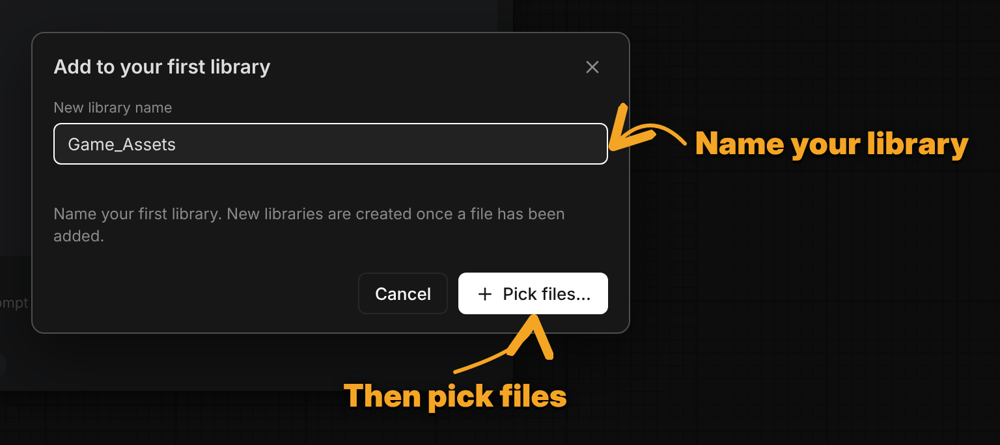

### 4. Add several files at once

Select several files in the file dialog: they are all added, each named after its file. Type `@`
in the prompt to see them.

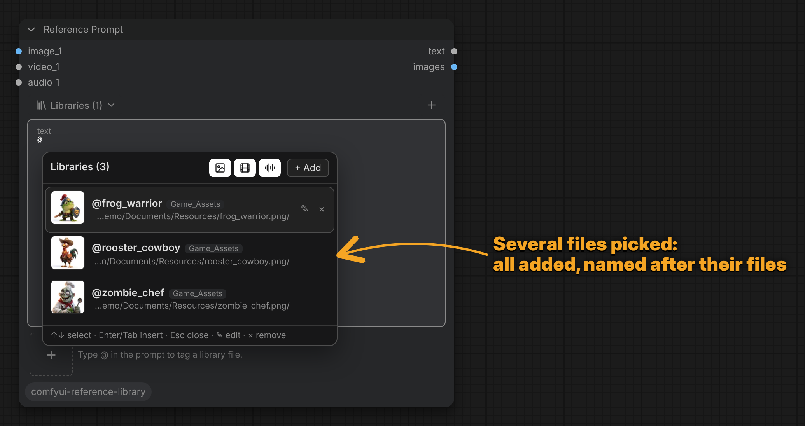

### 5. Add a single file

With **+ Add**, pick one file: you see its preview and can choose its `@name` before adding it.

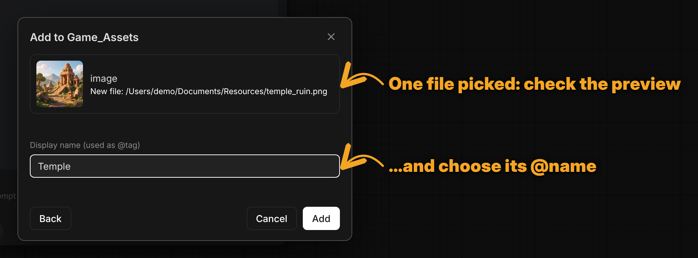

### 6. Change a display name

In the `@` list, hover a file and click **✎**. Rename it (tags already in your prompts follow), or
**Replace file…** to point it at another file of the same type.

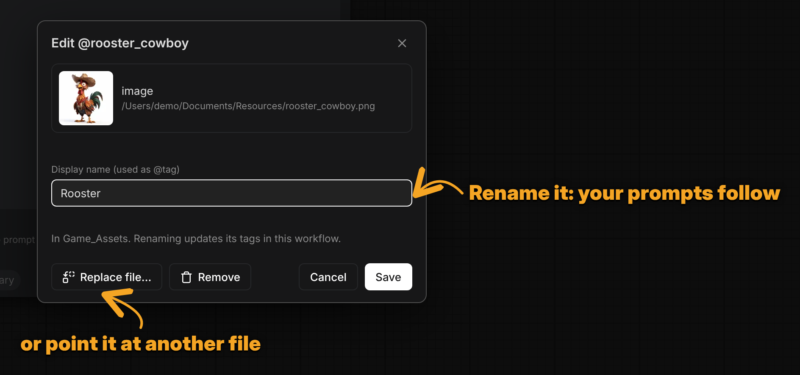

### 7. Mention an asset

Type `@` and a few letters, then **Enter** or **Tab** to insert. `↑` `↓` select, **Esc** closes. The
image / video / audio buttons at the top of the list show or hide each type (saved with the node).

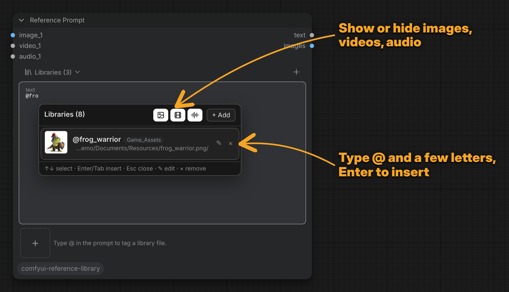

Tagged files appear under the text, in the order they will be sent (`image 1`, `image 2`, …):

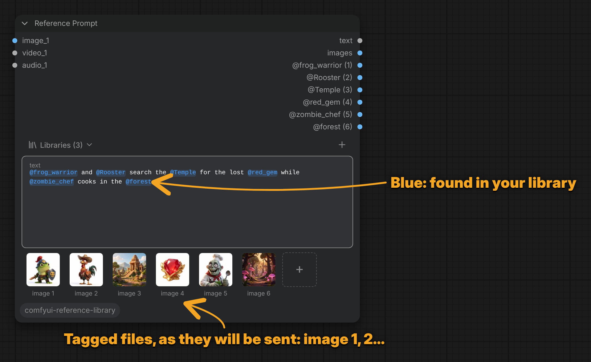

### 8. Hover a tag

Hover a tag in the text for a large preview, where it goes, and where the file is. On a library image,
the dotted-square button opens the slicer: see [Slices](#slices-use-part-of-an-image).

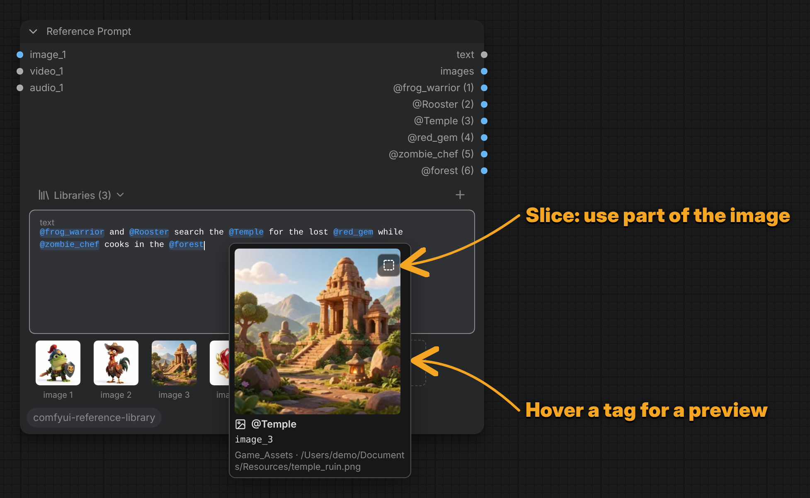

### 9. Find a tag from its thumbnail

Hover a thumbnail to highlight its tags (the tooltip names it); click it to jump to the tag (click again
for the next one).

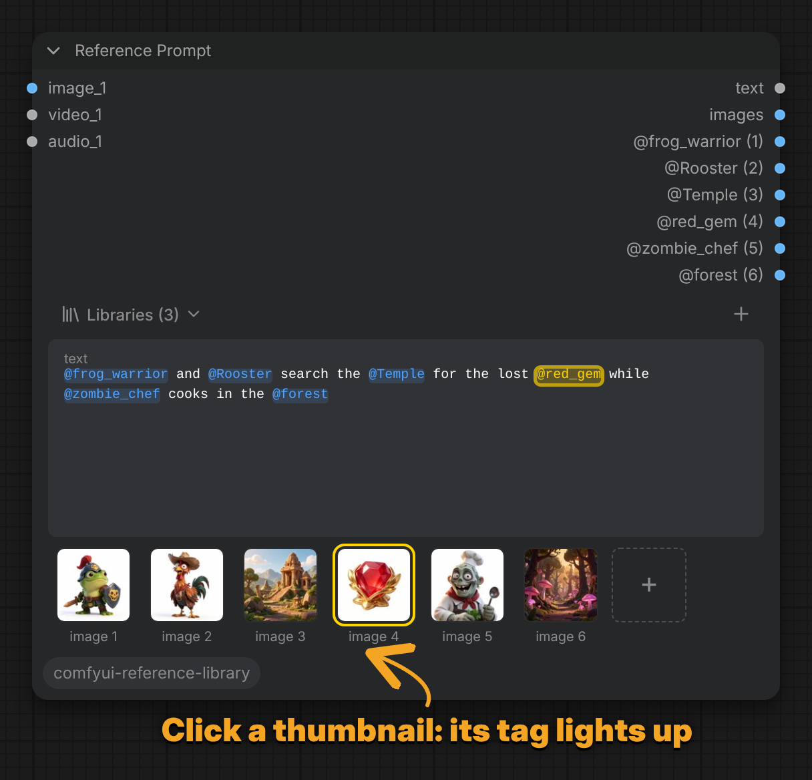

### 10. Connect it to a model

Connect the node's **text** output to the model's `prompt` (directly, or through string nodes such
as String Concatenate) and queue. Nothing else: the tagged files are wired into the model for you
(see [No image wires](#no-image-wires)). Works inside subgraphs too. Which models work:
[Supported model nodes](#supported-model-nodes).

### 11. Files that aren't in a library

Plug a Load Image (Video, Audio) into the node to tag its file for this run, before or after the
library files: see [Files that aren't in a library](#files-that-arent-in-a-library).

## Example workflow

A ready-made workflow is in [`example_workflows/`](example_workflows/) and, once the pack is installed, in
ComfyUI under **Templates → comfyui-reference-library**: one Reference Prompt feeding Nano Banana Pro,
Nano Banana 2.1 and Seedream, with two library files and one plugged-in image.

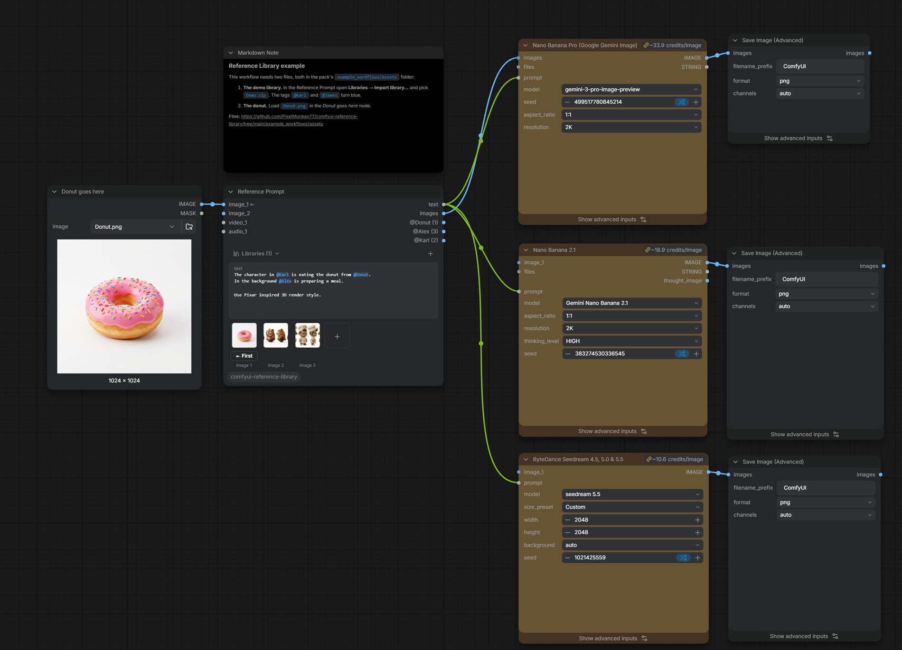

It uses a small demo library and a donut image, both in `example_workflows/assets/`:
**Libraries → Import library…** → `Demo.zip`, and load `Donut.png` in the *Donut goes here* node. Details in
[`example_workflows/README.md`](example_workflows/README.md).

## Tag colors

| Color | Meaning | Click it to… |
|---|---|---|
| Blue | An image, found in an enabled library (or a plugged-in file) | — |
| Cyan | A video, found | — |
| Green | An audio file, found | — |
| Red | Unknown name, or its plugged-in file was unplugged / muted | use the library's file of that name, if any |
| Purple | The library entry's file is missing on disk | replace the file |
| Grey, struck through | Its library is switched off in this node | enable the library |

Red, purple and grey tags block the queue with a notice, and **Export (API)** too: the file would hold
raw `@tags` without their files. Saving and exporting the workflow itself always works.

## What happens when you queue

For each model node with growing media inputs whose prompt comes from a Reference Prompt (directly, or
through string nodes):

1. Files you wired into the model by hand keep their inputs.
2. Then, on the next free inputs, up to the model's limit:
   plugged-in files set to **First** → library tags, in the order they first appear in the text →
   plugged-in files set to **Last** (see [Files that aren't in a library](#files-that-arent-in-a-library)).
3. In the prompt sent to the server, `@tags` become `image N` (or `Image N`, `Video N`, `Audio N`),
   numbered by input order. The canvas keeps the `@tags`.

Queueing is refused, with a message saying why, when a tag can't be used (see [Tag colors](#tag-colors)),
when a prompt tags more files than the model takes, or when a Reference Prompt with tags isn't connected to
any model it can fill (so raw `@tags` are never sent). E-mail addresses like `me@x.com` are ignored.

Workflows without a Reference Prompt are never touched: an `@word` in a prompt that no Reference Prompt
feeds stays as typed, even if it matches a library name, and queueing doesn't wait on the library.

## Supported model nodes

Any node with **numbered media inputs that grow as you connect them** (`images.image_1`, `image_2`, …)
and a **prompt** works, partner/API and open models alike. The limits come from the node and follow
the model selected on it.

Checked by building the prompt each node receives (which file goes on which input, and how the tags
are rewritten), not by paid runs:

**Image**

| Node | Images |
|---|---|
| Nano Banana 2.1 | 14 |
| ByteDance Seedream 4.5 & 5.0 | 14 with 5.0 lite; 10 with 5.0 pro, 5.0 flash, 4.5, 4.0 |
| OpenAI GPT Image 2.5 | 16 |
| FLUX 3 Image | 10 |
| Flux.2 Image ([pro], [max]) | 8 |
| Tencent HY Image: Edit | 5 (at least 1) |
| Qwen Image 3 Edit | 3 (at least 1) |
| Grok Image Edit | 3 (1 with grok-imagine-image-pro) |
| Ideogram 4.5 Edit / Precise Edit | 5 |
| Luma UNI-1 Image / Image Edit | 9 / 8 |
| Meta Muse Image Edit | 10 |
| OpenRouter Image | 5 |

**Video**

| Node | Images | Videos | Audio |
|---|---|---|---|
| ByteDance Seedance 2.5 Reference to Video | 30 (9 with 2.0, 2.0 Fast, 2.0 Mini) | 10 (3) | 10 (3) |
| MiniMax H3 Reference to Video (H3, H3 Max) | 9 | 3 | 3 |
| Vidu Q4 Reference-to-Video | 15 | | 3 |
| HeyGen Video 1.0 Reference to Video | 9 | 3 | 3 |
| Google Gemini Omni (Video) | 14 | 3 | |

**Text (describe or compare images in a chat model)**

| Node | Images | Videos | Audio |
|---|---|---|---|
| Anthropic Claude | 20 | | |
| Google Gemini | 16 | 1 | 1 |

**Open models (local text encoders for image editing)**

| Node | Images |
|---|---|
| Text Encode Qwen Image 2.1 | 16 |
| Text Encode Ming Image Edit | 8 |
| TextEncodeBooguEdit, TextEncodeMageFlowEdit | 16 |

Reference-to-video nodes (Seedance, MiniMax H3, Vidu, HeyGen) are told `Image 1`, `Video 1`,
`Audio 1`; the others `image 1`.

**Models with one `images` batch input** (Nano Banana Pro, Nano Banana, …): connect the Reference Prompt's
`images` output too, see [Older models with one image input](#older-models-with-one-image-input).

**Not supported:** nodes with a single image input, or one batch input, such as **LTX 2.5** (API: Image /
Audio to Video), the **LTX-2** open-model nodes, and the **MiniMax H3** open model (Reference to Video takes
`ref_images` as one batch). Wire files into those by hand (the `@name` outputs help), or try the `images`
batch output where the model accepts a batch. A Reference Prompt with `@tags` whose text reaches only such a
node, with none of its outputs used, won't queue rather than send raw tags.

## Older models with one image input

Using an old reliable model like **Nano Banana Pro**, with just one `images` input? No problem. These
models take all their reference images as one batch, so the Reference Prompt can't fill their inputs on its
own. That's what its **`images`** output is for. Connect two wires:

1. **`text`** → the model's **`prompt`**
2. **`images`** → the model's **`images`**

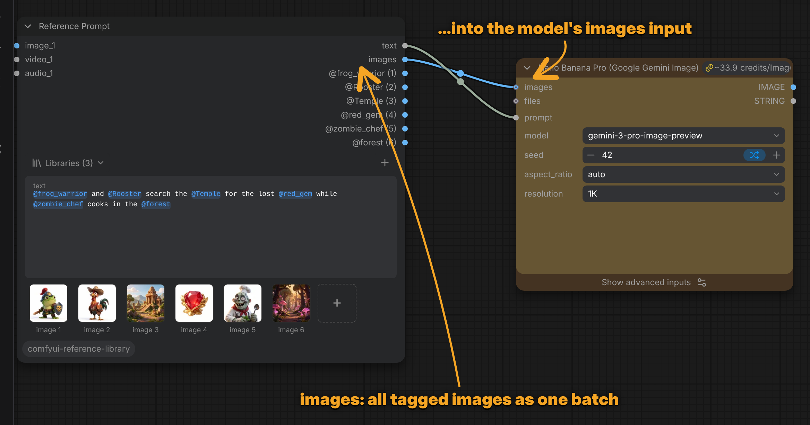

That's it. When you queue:

- The `images` output becomes a batch of every tagged image, in the order of the numbers on the outputs
  (`@frog_warrior (1)` first, `@Rooster (2)` second, …) and under the thumbnails.
- The prompt is rewritten to match: `@frog_warrior` becomes "image 1", `@Rooster` "image 2", and so on.
- A batch needs one size for all images, so each image is **fitted inside the size of image 1 and padded**
  (black bars). Nothing is cropped away.

**Want control over the resizing?** Skip `images` and use the separate `@name` outputs instead: resize,
crop or pad each image your way, then batch them with your own nodes, in the order of their numbers.

**Forgot the `images` wire?** The queue is refused with a message saying the model gets the text but none
of the tagged files, rather than running without your references.

**Why isn't this automatic?** This is legacy support: newer models have separate `image_1`, `image_2`…
inputs, which the Reference Prompt fills on its own, no wires needed. For batch-input models the `images`
wire stays manual on purpose, so you always see where the padding happens and can swap in your own
resizing.

## Files that aren't in a library

Images, videos and audio from any other node (**Load Image**, **Load Video**, **Load Audio**, a
generated image, …) can be tagged too, for the current run, without adding them to a library.

**1. Plug it in.** Connect the file to the Reference Prompt's `image_1` (or `video_1`, `audio_1`). A new
free input appears each time one is used.

**2. Tag it.** It is named after its file (`Night_Forest.png` → `@Night_Forest`; a Reference Image node's
`name` works too). It is listed first in the `@` list, marked *this run*, and gets a thumbnail in the strip.

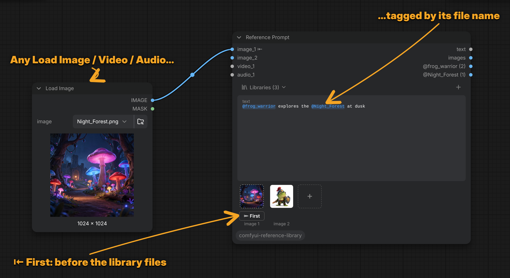

**3. Choose its place: before or after the library files.** The button under its thumbnail switches between
**⇤ First** (the default: it takes the first inputs, before the library files) and **Last ⇥** (after
them). The numbers under the thumbnails show the result straight away.

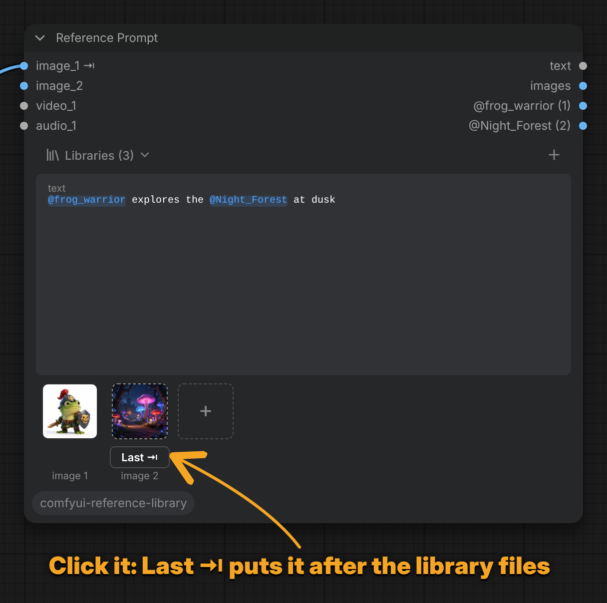

Several plugged-in files keep their input order within each group (`image_1` before `image_2`).
The full order on the model is: files wired into the model by hand → **First** files → library tags →
**Last** files.

Good to know:

- A plugged-in file **never takes over a library asset** with the same name: it gets `@Name_2` instead
  (`@Name_3` for a third…), and the plain `@Name` keeps meaning the library file. Your text is never
  rewritten for you.
- **Its tag follows the file.** Pick or paste another image into the plugged-in Load Image, and its tag is
  renamed to the new file's name everywhere in this node's text, along with its output (wires kept):
  `@Red` becomes `@Blue`. Undo puts both back. (While it's unplugged, nothing is renamed.)
- Unplugged or muted, its tags turn red and the queue is refused, so the run never silently uses a
  different file. Plug it back in (or click the red tag to use a library file of that name).
- You can also wire a file **straight into the model's input**; it keeps that input, and its file name
  works as a tag.
- It also gets its own output on the Reference Prompt, like library files: see [Outputs](#outputs-every-tagged-file-and-a-batch).

## Edit a library: manage its files

Open **Libraries** in the node's header and click **✎** next to a library. One window shows the whole
library:

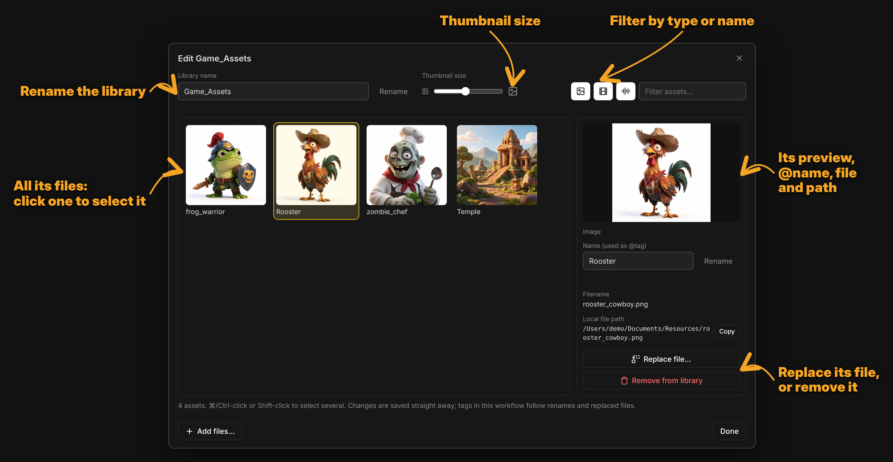

- **The library's name** at the top: change it and click **Rename** (tags that name the library, like
  `@Game_Assets/Rooster`, follow).
- **All its files** in a scrollable grid. The **Thumbnail size** slider makes them bigger or smaller; the
  image / video / audio buttons and the filter field narrow the list down. Files that are missing on disk
  are marked purple.
- **The selected file** on the right: a large preview (videos and audio play), its `@name`, its file name
  and the full path on your disk (**Copy** puts it on the clipboard).
  - **Rename:** type a new `@name` and press **Enter** or **Rename**. Tags in your prompts follow.
  - **Replace file…** points it at another file of the same type (or finds a moved file). Its `@name`
    stays, so your prompts keep working.
  - **Remove from library** forgets it; the file itself stays on your disk.
- **+ Add files…** adds more files to this library.

**Several at once.** ⌘/Ctrl-click or Shift-click files (or Shift+arrows, ⌘/Ctrl+A for all shown) to select
several, then remove them together. Renaming, replacing, copying the path and the preview work on one file
at a time, so they're switched off while several are selected.

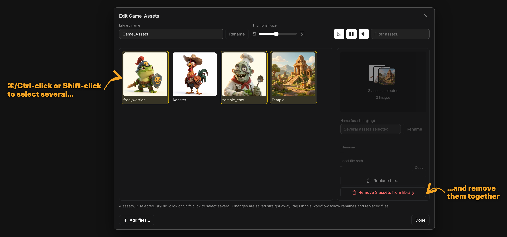

Every change is saved straight away. From the keyboard: arrows move through the grid, Space adds or takes
out one, **Delete** removes, **F2** or **Enter** renames.

## Slices: use part of an image

Need only a face, a prop or a corner of a library image? Hover its tag in the prompt and click the
**dotted square** in the top-right corner of the preview (see [Hover a tag](#8-hover-a-tag)). The image
opens large:

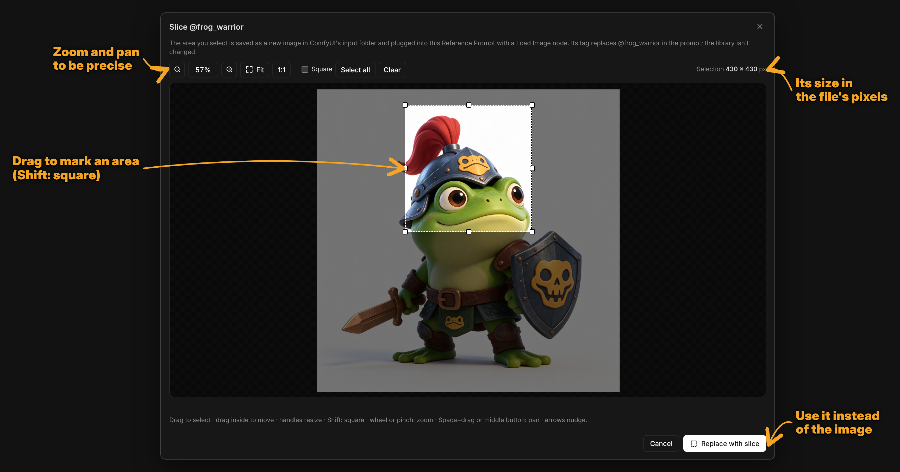

- **Drag** to mark an area. Drag inside it to move it; the handles resize it. Hold **Shift** (or tick
  **Square**) to keep it square. **Select all**, **Clear**, and the arrow keys nudge it.
- **Zoom** with the mouse wheel or a trackpad pinch (or **−** / **+**, **Fit**, **1:1**), and **pan** with
  Space+drag or the middle mouse button.
- The selection's size is shown in the file's own pixels, so you know what the model will get.

Click **Replace with slice**:

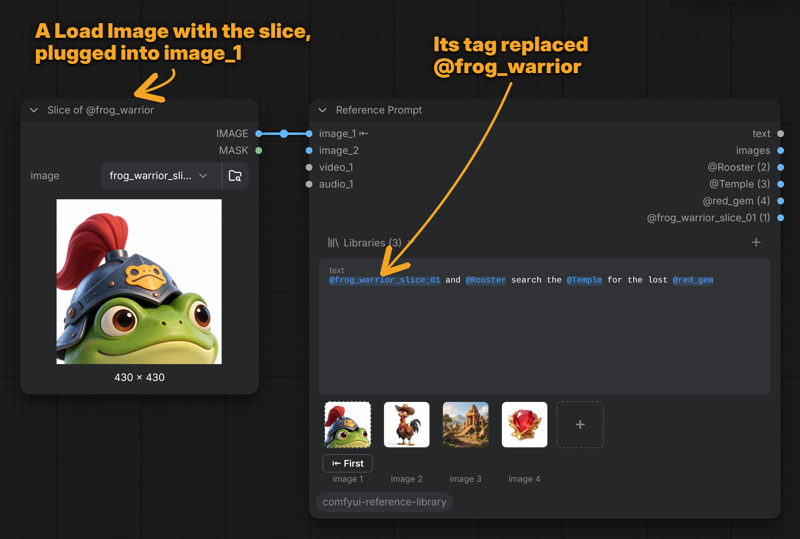

1. The area is cut out of the **full-size file** and saved as a new PNG in ComfyUI's `input` folder:
   `frog_warrior_slice_01.png`, then `_02`, … for the next ones.
2. A **Load Image** node, "Slice of @frog_warrior", is added next to the Reference Prompt and plugged into
   its next free `image_N` input.
3. Every tag of that image in this prompt (`@frog_warrior`, `@Game_Assets/frog_warrior`) becomes the
   slice's tag, `@frog_warrior_slice_01`.

From there the slice is a [file that isn't in a library](#files-that-arent-in-a-library): it has its own
thumbnail and output, and First/Last decides where it goes. **The library isn't changed**: the original file
stays in it, untouched, for your other prompts. To go back, delete the Load Image node and type the original
tag again.

## Outputs: every tagged file, and a batch

Next to `text`, the Reference Prompt has an output for **every tagged file**, library files and plugged-in
files alike, plus one **`images`** output with all tagged images as a batch. The number after each name is
where that file goes: **`@frog_warrior (1)`** is `image_1` (`(2)` is `image_2`, …). The numbers follow First/Last
and match the numbers under the thumbnails and the "image 1, image 2…" in the prompt.

The `images` output is made for models with a single `images` input (Nano Banana Pro, …): see
[Older models with one image input](#older-models-with-one-image-input). Images are padded to the size of
image 1; for your own resizing, batch the `@name` outputs yourself.

The `@name` outputs also work anywhere else an image (video, audio) goes: previews, upscalers,
IP-Adapter, …

**Outputs follow the tags.** When a tag leaves the text, or its plugged-in file is unplugged or swapped for
another file, its output goes away. If you've wired it to something, the wire is never cut for you: the
output stays, marked with the reason (`@Rooster ⚠ not in text`, `⚠ unplugged`, `⚠ file changed`, …), and the
queue is refused until you put the tag or file back or remove that wire (the label is shown in red). So a model never gets an image the
prompt doesn't name.

## Libraries in detail

- **Local libraries only (for now).** A library points to files on the disk of the computer running
  ComfyUI. Web links, cloud storage links (Google Drive, Dropbox, …) and Comfy Cloud aren't supported.
  A workflow opened on another computer finds its tags only if that computer has the library too:
  [export it and import it there](#share-a-library-export-and-import).
- **Several libraries.** A plain `@Rooster` means the first enabled library that has it;
  `@Library_02/Rooster` names the library (typing `@Library_02/` in the list shows only that library).
- **Per node:** switch libraries on or off in each node's **Libraries** menu, which also edits and
  deletes libraries.
- **Edit a library:** click **✎** next to it in the **Libraries** menu: see
  [Edit a library](#edit-a-library-manage-its-files).
- **Tags follow changes.** Renaming, replacing or removing an asset, or deleting or switching a
  library, keeps every tag in the open workflow on its file (renames follow; a removed file's tag
  turns red).
- **Names** use letters, digits, `_` and `-` (other characters become `_`), are unique within a
  library, and are case-insensitive.
- **Storage:** `ComfyUI/user/default/library_image/library.json`, with a `.bak` of the previous
  version (a damaged file is set aside and the backup restored). Thumbnails are cached inside the pack's
  own folder (`.cache/thumbs`) and rebuilt when needed.

## Share a library: export and import

A workflow stores `@names`, not files, so it needs its libraries on every computer it runs on.

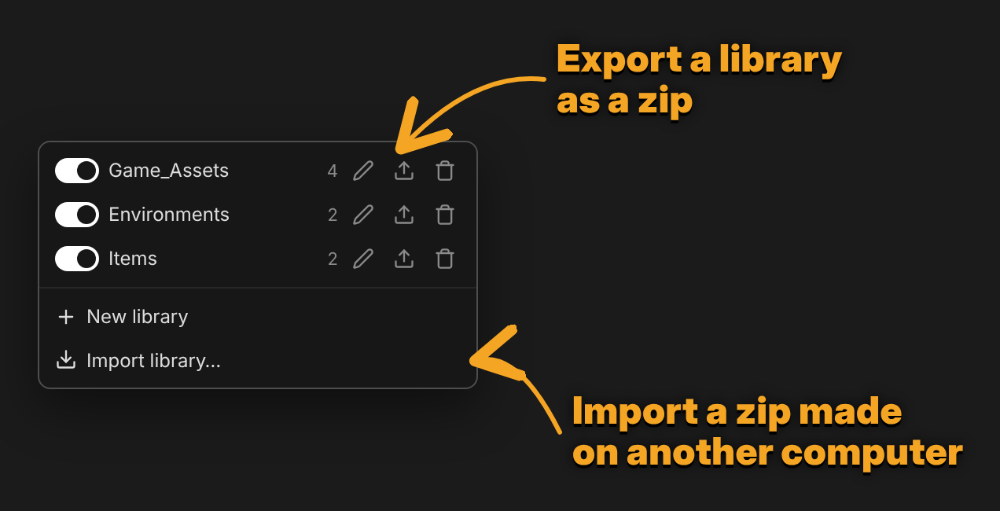

**Export:** in a Reference Prompt's **Libraries** menu, click the export button (arrow out of a tray) next
to a library. A list of all your libraries opens with that one ticked; tick any others that should travel
with it. **Choose folder and export…** then opens your system's folder dialog (Windows, macOS and Linux),
and the ticked libraries are saved there together as one zip: `<Library name>.zip` for a single library,
`Reference_Libraries.zip` for several. An existing zip is never overwritten (`<name>_2.zip`, …).

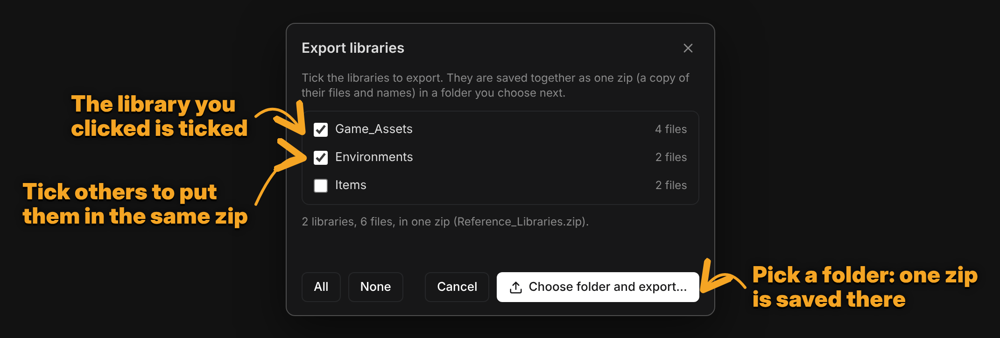

The zip holds a copy of every file plus the libraries' and files' names. No folder names from your disk are
in it. Files that are missing on disk are left out, and the notice names them.

**Import:** on the other computer, **Libraries → Import library…** and pick the zip.

- Each library's files are unpacked to `ComfyUI/input/reference_library/<Library name>/` and the libraries
  appear with the same names and the same `@names`, so the workflow's tags turn green.
- **Importing a newer export of a library you already have** adds only the files that are new. Files you
  already have, and anything you renamed or removed on this computer, are left as they are.
- If another library already has that name, the imported one gets `<name>_2`. Plain tags (`@Rooster`) still
  work; tags that name the library (`@Team/Rooster`) need the library renamed.
- Only images, videos and audio are unpacked, and only into that folder, whatever the zip says.

Export and import work only on the computer running ComfyUI, like every other change to a library.

## Run a workflow without the interface (API)

**Export (API)** in the interface saves the workflow as ComfyUI runs it: the tags are already turned into
wiring, and every tagged library file is a small node that names the file by library, name and id:

```json
"libimg_1": {
  "class_type": "ReferenceLibraryImage",
  "inputs": { "name": "Karl", "library": "Demo", "asset": "fbda8ea52ba9" }
}
```

There are no folder names in it, so the file is safe to share, and it runs on any ComfyUI that has the
library, whatever folder its files are in there:

1. **Bring the library over once.** [Export it](#share-a-library-export-and-import) and import it on the
   computer that runs the workflow: in the interface, or from that computer's own command line:

   ```
   curl -X POST http://127.0.0.1:8188/library_image/library/import -H "Content-Type: application/json" -d "{\"path\": \"/full/path/to/Demo.zip\"}"
   ```
2. **Queue the exported file** the usual way (`POST /prompt`).

[`example_workflows/api/Reference_Library_example_API.json`](example_workflows/api/Reference_Library_example_API.json)
is the [example workflow](#example-workflow) exported this way.

- **To use another library file from a script,** change `name` (and `library`) on that node and leave
  `asset` out: the file is found by its names. With `asset`, the id decides. `ReferenceLibraryVideo` and
  `ReferenceLibraryAudio` work the same way.
- A file that isn't in that computer's libraries stops the run with a message that names it; a library named
  in the node is never swapped for another one that happens to have a file of that name.
- `@tags` become wiring when a workflow is queued or exported **in the interface**. A hand-written API
  prompt with `@Karl` in its text is not interpreted by the server: use the node above.
- Reference Image / Video / Audio nodes you place on the canvas yourself still hold the path you typed.

## Reference Image / Video / Audio nodes

Load one file by full path, with **Browse…**. Optional, for wiring files by hand; their `name` works as
an `@tag` too (so does a Load Image's file name).

For safety they only read files from **folders you've already used**: folders you picked a file in
(Browse… or + Add), folders that hold library files, and ComfyUI's input/output folders. A path typed
into a new folder shows a yellow note on the node: click **Browse…** and pick the file once, and from
then on paths in that folder work.

## Safety

- Picking files and changing libraries work only on the PC running ComfyUI, opened as
  `http://127.0.0.1:…` or `http://localhost:…`.
- Other machines (ComfyUI started with `--listen`) can browse the libraries and see file names, but not
  your folders.
- Requests from other websites, or under other host names (DNS rebinding, proxies), are refused.
- Without the trusted-folder rule above, a shared workflow, a web page or another machine could make
  the loader nodes read, and send to an API, any picture on your disk.

## Install

**Requirement: Nodes 2.0.** The Reference Prompt's thumbnails, `@` list, tag colors and dialogs are built
for ComfyUI's modern node design. Turn it on in **Settings → Comfy → Nodes 2.0 → Modern Node Design
(Nodes 2.0)**. With the classic canvas nodes the pack doesn't work; a notice says so when a Reference
Prompt is used while Nodes 2.0 is off.

**Versions:** known to work from ComfyUI 0.45.0 with frontend 1.55.18. On an older frontend a notice asks
you to update ComfyUI.

ComfyUI loads custom nodes from `ComfyUI/custom_nodes/`. For ComfyUI Desktop that folder is inside the
base folder you chose at setup (e.g. `Documents\ComfyUI\custom_nodes`); for the portable build it is
`ComfyUI_windows_portable\ComfyUI\custom_nodes`.

**ComfyUI Manager:** **Install via Git URL** → `https://github.com/PixelMonkey77/comfyui-reference-library`

**Git:**

```
cd ComfyUI/custom_nodes
git clone https://github.com/PixelMonkey77/comfyui-reference-library
```

Other tagging nodes that react to `@` in prompts can conflict with this one.

**Uninstall:** uninstall it in the Extensions panel / ComfyUI Manager, or delete
`custom_nodes/comfyui-reference-library`, and restart ComfyUI. That removes the pack and its thumbnail
cache.

Your libraries are kept on purpose, so reinstalling or updating never loses them: a few small files in
`ComfyUI/user/default/library_image/` (`library.json`, its `.bak` backup and an empty `.lock` file). Delete
that folder too for a completely clean uninstall. Your images, videos and audio files are never touched:
libraries only point to them.

## Development

- `__init__.py` is what ComfyUI imports; the backend is the `reference_library/` package next to it, one
  module per concern (`store` for `library.json`, `library` for changes, `transfer` for export / import,
  `thumbs`, `slices`, `dialogs`, `guard` for request trust, `nodes`, and `routes`, which lists every HTTP
  route). The interface is in `web/`.
- `tests/`: offline server tests (run with ComfyUI's Python, no running server needed) and a browser
  regression harness for the canvas and queue binding; see [`tests/README.md`](tests/README.md).
- `tools/screenshots/`: recreates the images above, callouts included, with one command
  (`node tools/screenshots/make_screenshots.mjs`); see
  [`tools/screenshots/README.md`](tools/screenshots/README.md).

## Releasing

Releases go to the [Comfy Registry](https://registry.comfy.org), which ComfyUI Manager installs from.
Bump `version` in `pyproject.toml` (and add a [`CHANGELOG.md`](CHANGELOG.md) entry) and push to `main`:
the workflow in `.github/workflows/publish.yml` publishes it. One-time setup: a publisher on the
registry, its id in `pyproject.toml` (`PublisherId`), and its API key as the repo secret
`REGISTRY_ACCESS_TOKEN`. A version can't be published twice.

## Disclaimer

This tool is **highly experimental**. It is provided as is, without warranty of any kind. Use it at your
own risk: you are responsible for how you use it and for any damage or loss it may cause (to files,
libraries, workflows, API credits or anything else). The author accepts no liability.

## License

MIT, see [`LICENSE`](LICENSE).
