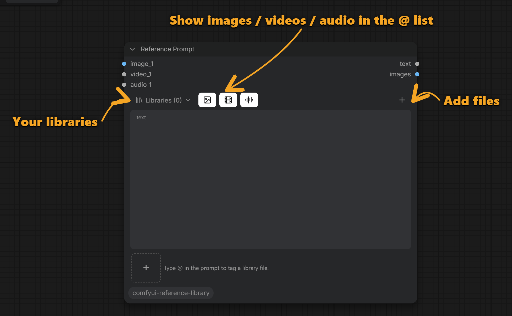
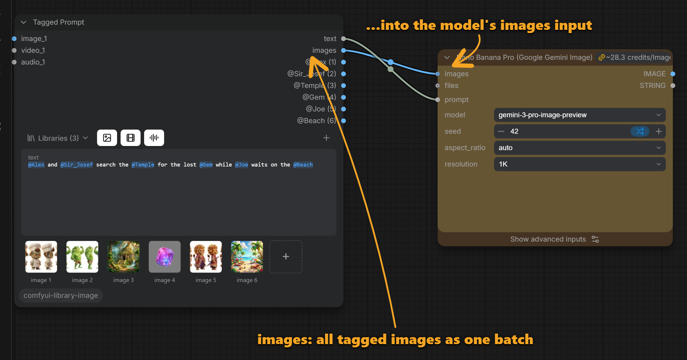

# Reference Library for ComfyUI

A reference library for ComfyUI. Keep your characters, places, props, clips and sounds in **named
libraries**, then type **`@name`** in a **Reference Prompt** and they're wired into the model when you
queue: **Nano Banana**, **Seedream**, **GPT Image**, **FLUX 3**, **Seedance**, **MiniMax H3**,
**Qwen Image**, … (see [Supported model nodes](#supported-model-nodes)). Files stay where they are on your
disk ([local libraries only](#libraries-in-detail), for now): no copying into ComfyUI's `input` folder.

> **Requires Nodes 2.0.** Turn on **Settings → Comfy → Nodes 2.0 → Modern Node Design (Nodes 2.0)**.
> The classic canvas nodes aren't supported. See [Install](#install).

> **Highly experimental: use at your own risk.** See [Disclaimer](#disclaimer).

## No image wires

**You don't connect any images to the model node.** Usually every reference image needs its own Load
Image node, wired into `image_1`, `image_2`, … of the model, and the prompt has to say "image 3" for the
right one. Here the Reference Prompt is the **only** connection: its `text` goes to the model's `prompt`,
and that's it.

<p align="center">
  
</p>

When you queue, every file you tagged is loaded and plugged into the model's image (video, audio)
inputs for you, in the order shown under the text, and `@Alex` becomes `image 1` in the prompt the
model receives. Add a tag, and one more image goes along; remove it, and it's gone. The canvas stays
the same two nodes, however many references you use.

- **Asset libraries:** named collections of your files, referenced in place, shared by all workflows.
- **`@` autocomplete** with thumbnails; tags colored by state; hover a tag for a preview.
- **Images, videos and audio**, plus [files from other nodes](#files-that-arent-in-a-library)
  (Load Image, …), placed before or after the library files.

## Contents

- [No image wires](#no-image-wires)
- [Getting started](#getting-started)
- [Tag colors](#tag-colors)
- [What happens when you queue](#what-happens-when-you-queue)
- [Supported model nodes](#supported-model-nodes)
- [Older models with one image input](#older-models-with-one-image-input)
- [Files that aren't in a library](#files-that-arent-in-a-library)
- [Outputs: every tagged file, and a batch](#outputs-every-tagged-file-and-a-batch)
- [Libraries in detail](#libraries-in-detail)
- [Reference Image / Video / Audio nodes](#reference-image--video--audio-nodes)
- [Safety](#safety)
- [Install](#install)
- [Development](#development)
- [Disclaimer](#disclaimer)

## Getting started

### 1. The Reference Prompt node

Add it from **Add Node → image → library → Reference Prompt**. The header holds your libraries, the
filters for the `@` list, and the button to add files.



### 2. Create your first library

Open **Libraries** and click **+ New library**.


### 3. Name it, then pick files

Give the library a name. It is created as soon as the first file is added.


### 4. Add several files at once

Select several files in the file dialog: they are all added, each named after its file. Type `@`
in the prompt to see them.


### 5. Add a single file

With **+ Add**, pick one file: you see its preview and can choose its `@name` before adding it.


### 6. Change a display name

In the `@` list, hover a file and click **✎**. Rename it (tags already in your prompts follow), or
**Replace file…** to point it at another file of the same type.


### 7. Mention an asset

Type `@` and a few letters, then **Enter** or **Tab** to insert. `↑` `↓` select, **Esc** closes.


Tagged files appear under the text, in the order they will be sent (`image 1`, `image 2`, …):


### 8. Hover a tag

Hover a tag in the text for a large preview, where it goes, and where the file is.


### 9. Find a tag from its thumbnail

Hover a thumbnail to highlight its tags (the tooltip names it); click it to jump to the tag (click again
for the next one).


### 10. Connect it to a model

Connect the node's **text** output to the model's `prompt` (directly, or through string nodes such
as String Concatenate) and queue. Nothing else: the tagged files are wired into the model for you
(see [No image wires](#no-image-wires)). Works inside subgraphs too. Which models work:
[Supported model nodes](#supported-model-nodes).

### 11. Files that aren't in a library

Plug a Load Image (Video, Audio) into the node to tag its file for this run, before or after the
library files: see [Files that aren't in a library](#files-that-arent-in-a-library).

## Tag colors

| Color | Meaning | Click it to… |
|---|---|---|
| Blue | Found in an enabled library (or a plugged-in file) | — |
| Red | Unknown name, or its plugged-in file was unplugged / muted | use the library's file of that name, if any |
| Purple | The library entry's file is missing on disk | replace the file |
| Grey, struck through | Its library is switched off in this node | enable the library |

Red, purple and grey tags block the queue with a notice. **Export (API)** still works.

## What happens when you queue

For each model node with growing media inputs whose prompt contains `@tags`:

1. Files you wired into the model by hand keep their inputs.
2. Then, on the next free inputs, up to the model's limit:
   plugged-in files set to **First** → library tags, in the order they first appear in the text →
   plugged-in files set to **Last** (see [Files that aren't in a library](#files-that-arent-in-a-library)).
3. In the prompt sent to the server, `@tags` become `image N` (or `Image N`, `Video N`, `Audio N`),
   numbered by input order. The canvas keeps the `@tags`.

Queueing is refused, with a message saying why, when a tag can't be used (see [Tag colors](#tag-colors)),
when a prompt tags more files than the model takes, or when a Reference Prompt with tags isn't connected to
any model it can fill (so raw `@tags` are never sent). A stray `@word` typed straight into a model's own
prompt is left as text, and e-mail addresses like `me@x.com` are ignored.

## Supported model nodes

Any node with **numbered media inputs that grow as you connect them** (`images.image_1`, `image_2`, …)
and a **prompt** works, partner/API and open models alike. The limits come from the node and follow
the model selected on it.

Checked by building the prompt each node receives (which file goes on which input, and how the tags
are rewritten), not by paid runs:

**Image**

| Node | Images |
|---|---|
| Nano Banana 2.1 | 14 |
| ByteDance Seedream 4.5 & 5.0 | 14 with 5.0 lite; 10 with 5.0 pro, 5.0 flash, 4.5, 4.0 |
| OpenAI GPT Image 2.5 | 16 |
| FLUX 3 Image | 10 |
| Flux.2 Image ([pro], [max]) | 8 |
| Tencent HY Image: Edit | 5 (at least 1) |
| Qwen Image 3 Edit | 3 (at least 1) |
| Grok Image Edit | 3 (1 with grok-imagine-image-pro) |
| Ideogram 4.5 Edit / Precise Edit | 5 |
| Luma UNI-1 Image / Image Edit | 9 / 8 |
| Meta Muse Image Edit | 10 |
| OpenRouter Image | 5 |

**Video**

| Node | Images | Videos | Audio |
|---|---|---|---|
| ByteDance Seedance 2.5 Reference to Video | 30 (9 with 2.0, 2.0 Fast, 2.0 Mini) | 10 (3) | 10 (3) |
| MiniMax H3 Reference to Video (H3, H3 Max) | 9 | 3 | 3 |
| Vidu Q4 Reference-to-Video | 15 | | 3 |
| HeyGen Video 1.0 Reference to Video | 9 | 3 | 3 |
| Google Gemini Omni (Video) | 14 | 3 | |

**Text (describe or compare images in a chat model)**

| Node | Images | Videos | Audio |
|---|---|---|---|
| Anthropic Claude | 20 | | |
| Google Gemini | 16 | 1 | 1 |

**Open models (local text encoders for image editing)**

| Node | Images |
|---|---|
| Text Encode Qwen Image 2.1 | 16 |
| Text Encode Ming Image Edit | 8 |
| TextEncodeBooguEdit, TextEncodeMageFlowEdit | 16 |

Reference-to-video nodes (Seedance, MiniMax H3, Vidu, HeyGen) are told `Image 1`, `Video 1`,
`Audio 1`; the others `image 1`.

**Models with one `images` batch input** (Nano Banana Pro, Nano Banana, …): connect the Reference Prompt's
`images` output too, see [Older models with one image input](#older-models-with-one-image-input).

**Not supported:** nodes with a single image input, or one batch input, such as **LTX 2.5** (API: Image /
Audio to Video), the **LTX-2** open-model nodes, and the **MiniMax H3** open model (Reference to Video takes
`ref_images` as one batch). Wire files into those by hand (the `@name` outputs help), or try the `images`
batch output where the model accepts a batch. A Reference Prompt with `@tags` whose text reaches only such a
node, with none of its outputs used, won't queue rather than send raw tags.

## Older models with one image input

Using an old reliable model like **Nano Banana Pro**, with just one `images` input? No problem. These
models take all their reference images as one batch, so the Reference Prompt can't fill their inputs on its
own. That's what its **`images`** output is for. Connect two wires:

1. **`text`** → the model's **`prompt`**
2. **`images`** → the model's **`images`**



That's it. When you queue:

- The `images` output becomes a batch of every tagged image, in the order of the numbers on the outputs
  (`@Alex (1)` first, `@Sir_Josef (2)` second, …) and under the thumbnails.
- The prompt is rewritten to match: `@Alex` becomes "image 1", `@Sir_Josef` "image 2", and so on.
- A batch needs one size for all images, so each image is **fitted inside the size of image 1 and padded**
  (black bars). Nothing is cropped away.

**Want control over the resizing?** Skip `images` and use the separate `@name` outputs instead: resize,
crop or pad each image your way, then batch them with your own nodes, in the order of their numbers.

**Forgot the `images` wire?** The queue is refused with a message saying the model gets the text but none
of the tagged files, rather than running without your references.

**Why isn't this automatic?** This is legacy support: newer models have separate `image_1`, `image_2`…
inputs, which the Reference Prompt fills on its own, no wires needed. For batch-input models the `images`
wire stays manual on purpose, so you always see where the padding happens and can swap in your own
resizing.

## Files that aren't in a library

Images, videos and audio from any other node (**Load Image**, **Load Video**, **Load Audio**, a
generated image, …) can be tagged too, for the current run, without adding them to a library.

**1. Plug it in.** Connect the file to the Reference Prompt's `image_1` (or `video_1`, `audio_1`). A new
free input appears each time one is used.

**2. Tag it.** It is named after its file (`Night_Forest.png` → `@Night_Forest`; a Reference Image node's
`name` works too). It is listed first in the `@` list, marked *this run*, and gets a thumbnail in the strip.


**3. Choose its place: before or after the library files.** The button under its thumbnail switches between
**⇤ First** (the default: it takes the first inputs, before the library files) and **Last ⇥** (after
them). The numbers under the thumbnails show the result straight away.


Several plugged-in files keep their input order within each group (`image_1` before `image_2`).
The full order on the model is: files wired into the model by hand → **First** files → library tags →
**Last** files.

Good to know:

- A plugged-in file **never takes over a library asset** with the same name: it gets `@Name_2` instead
  (`@Name_3` for a third…), and the plain `@Name` keeps meaning the library file. Your text is never
  rewritten for you.
- Unplugged or muted, its tags turn red and the queue is refused, so the run never silently uses a
  different file. Plug it back in (or click the red tag to use a library file of that name).
- You can also wire a file **straight into the model's input**; it keeps that input, and its file name
  works as a tag.
- It also gets its own output on the Reference Prompt, like library files: see [Outputs](#outputs-every-tagged-file-and-a-batch).

## Outputs: every tagged file, and a batch

Next to `text`, the Reference Prompt has an output for **every tagged file**, library files and plugged-in
files alike, plus one **`images`** output with all tagged images as a batch. The number after each name is
where that file goes: **`@Coin (1)`** is `image_1` (`(2)` is `image_2`, …). The numbers follow First/Last
and match the numbers under the thumbnails and the "image 1, image 2…" in the prompt.

The `images` output is made for models with a single `images` input (Nano Banana Pro, …): see
[Older models with one image input](#older-models-with-one-image-input). Images are padded to the size of
image 1; for your own resizing, batch the `@name` outputs yourself.

The `@name` outputs also work anywhere else an image (video, audio) goes: previews, upscalers,
IP-Adapter, …

**Outputs follow the tags.** When a tag leaves the text, or its plugged-in file is unplugged or swapped for
another file, its output goes away. If you've wired it to something, the wire is never cut for you: the
output stays, marked with the reason (`@Coin ⚠ not in text`, `⚠ unplugged`, `⚠ file changed`, …), and the
queue is refused until you put the tag or file back or remove that wire. So a model never gets an image the
prompt doesn't name.

## Libraries in detail

- **Local libraries only (for now).** A library points to files on the disk of the computer running
  ComfyUI. Web links, cloud storage links (Google Drive, Dropbox, …) and Comfy Cloud aren't supported.
  Libraries also aren't shared: a workflow opened on another computer finds its tags only if that
  computer has a library with the same names. Sharing libraries is planned.
- **Several libraries.** A plain `@Biscuit` means the first enabled library that has it;
  `@Library_02/Biscuit` names the library (typing `@Library_02/` in the list shows only that library).
- **Per node:** switch libraries on or off in each node's **Libraries** menu, which also renames and
  deletes libraries.
- **Tags follow changes.** Renaming, replacing or removing an asset, or deleting or switching a
  library, keeps every tag in the open workflow on its file (renames follow; a removed file's tag
  turns red).
- **Names** use letters, digits, `_` and `-` (other characters become `_`), are unique within a
  library, and are case-insensitive.
- **Storage:** `ComfyUI/user/default/library_image/library.json`, with a `.bak` of the previous
  version (a damaged file is set aside and the backup restored). Thumbnails are cached inside the pack's
  own folder (`.cache/thumbs`) and rebuilt when needed.

## Reference Image / Video / Audio nodes

Load one file by full path, with **Browse…**. Optional, for wiring files by hand; their `name` works as
an `@tag` too (so does a Load Image's file name).

For safety they only read files from **folders you've already used**: folders you picked a file in
(Browse… or + Add), folders that hold library files, and ComfyUI's input/output folders. A path typed
into a new folder shows a yellow note on the node: click **Browse…** and pick the file once, and from
then on paths in that folder work.

## Safety

- Picking files and changing libraries work only on the PC running ComfyUI, opened as
  `http://127.0.0.1:…` or `http://localhost:…`.
- Other machines (ComfyUI started with `--listen`) can browse the libraries and see file names, but not
  your folders.
- Requests from other websites, or under other host names (DNS rebinding, proxies), are refused.
- Without the trusted-folder rule above, a shared workflow, a web page or another machine could make
  the loader nodes read, and send to an API, any picture on your disk.

## Install

**Requirement: Nodes 2.0.** The Reference Prompt's thumbnails, `@` list, tag colors and dialogs are built
for ComfyUI's modern node design. Turn it on in **Settings → Comfy → Nodes 2.0 → Modern Node Design
(Nodes 2.0)**. With the classic canvas nodes the pack doesn't work.

ComfyUI loads custom nodes from `ComfyUI/custom_nodes/`. For ComfyUI Desktop that folder is inside the
base folder you chose at setup (e.g. `Documents\ComfyUI\custom_nodes`); for the portable build it is
`ComfyUI_windows_portable\ComfyUI\custom_nodes`.

**ComfyUI Manager:** **Install via Git URL** → `https://github.com/PixelMonkey77/comfyui-reference-library`

**Git:**

```
cd ComfyUI/custom_nodes
git clone https://github.com/PixelMonkey77/comfyui-reference-library
```

Other tagging nodes that react to `@` in prompts can conflict with this one.

**Uninstall:** uninstall it in the Extensions panel / ComfyUI Manager, or delete
`custom_nodes/comfyui-reference-library`, and restart ComfyUI. That removes the pack and its thumbnail
cache.

Your libraries are kept on purpose, so reinstalling or updating never loses them: a few small files in
`ComfyUI/user/default/library_image/` (`library.json`, its `.bak` backup and an empty `.lock` file). Delete
that folder too for a completely clean uninstall. Your images, videos and audio files are never touched:
libraries only point to them.

## Development

- `tests/`: offline server tests (run with ComfyUI's Python, no running server needed) and a browser
  regression harness for the canvas and queue binding; see [`tests/README.md`](tests/README.md).
- `tools/screenshots/`: recreates the images above, callouts included, with one command
  (`node tools/screenshots/make_screenshots.mjs`); see
  [`tools/screenshots/README.md`](tools/screenshots/README.md).

## Releasing

Releases go to the [Comfy Registry](https://registry.comfy.org), which ComfyUI Manager installs from.
Bump `version` in `pyproject.toml` (and add a [`CHANGELOG.md`](CHANGELOG.md) entry) and push to `main`:
the workflow in `.github/workflows/publish.yml` publishes it. One-time setup: a publisher on the
registry, its id in `pyproject.toml` (`PublisherId`), and its API key as the repo secret
`REGISTRY_ACCESS_TOKEN`. A version can't be published twice.

## Disclaimer

This tool is **highly experimental**. It is provided as is, without warranty of any kind. Use it at your
own risk: you are responsible for how you use it and for any damage or loss it may cause (to files,
libraries, workflows, API credits or anything else). The author accepts no liability.

## License

MIT, see [`LICENSE`](LICENSE).
