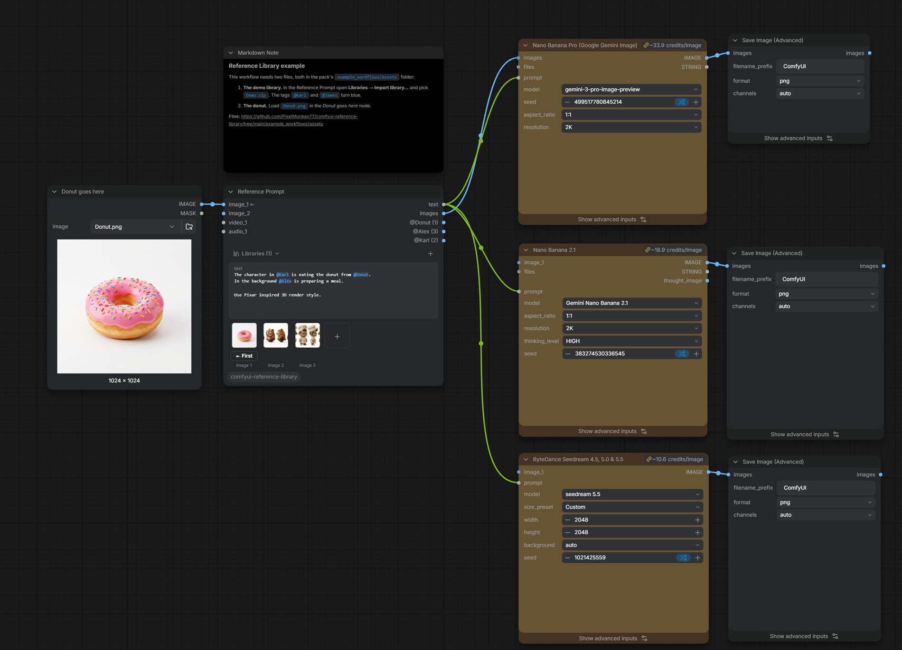

# Example workflow

`Reference_Library_example.json` sends one Reference Prompt to three image models (Nano Banana Pro,
Nano Banana 2.1 and Seedream). The prompt tags two library files, `@Karl` and `@Alex`, and one image that
isn't in a library, plugged in from a Load Image node (`@Donut`).

In ComfyUI it is listed under **Templates → comfyui-reference-library**. You can also drag the `.json` onto
the canvas.

## Set it up

The workflow needs two files from the `assets/` folder:

1. **The demo library, `assets/Demo.zip`.** In the Reference Prompt, open **Libraries → Import library…** and
   pick the zip. It adds a library called **Demo** with two character images, Karl and Alex; its files are unpacked to
   `ComfyUI/input/reference_library/Demo/`.
2. **The donut, `assets/Donut.png`.** Load it in the *Donut goes here* node (or copy it into `ComfyUI/input`
   first, where the node already looks for `Donut.png`). Any image of your own works too; its tag is then
   named after that file.

Then queue. The three model nodes are partner (API) nodes and use credits.

## What it shows

- **No image wires to the models.** Nano Banana 2.1 and Seedream have `image_1`, `image_2`… inputs: the
  tagged files are wired in when you queue, and the tags become `image 1`, `image 2`, `image 3` in the text.
- **A model with one `images` input** (Nano Banana Pro): the Reference Prompt's **images** output sends the
  same files as one batch, in the same order.
- **A file that isn't in a library:** the donut is plugged into the Reference Prompt's `image_1` input and
  tagged like a library file. It is set to **First**, so it is image 1.
